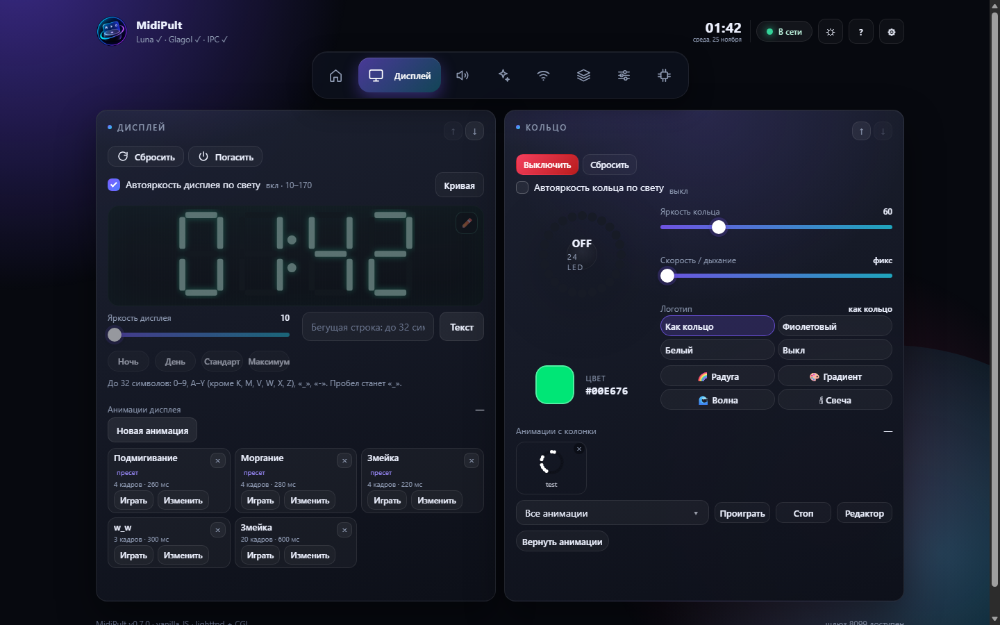
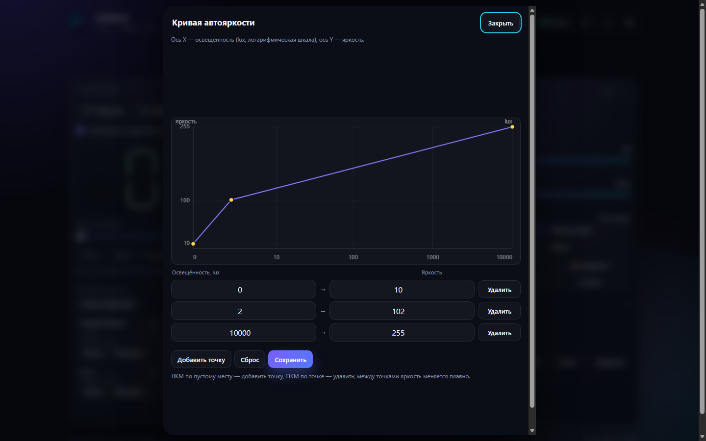
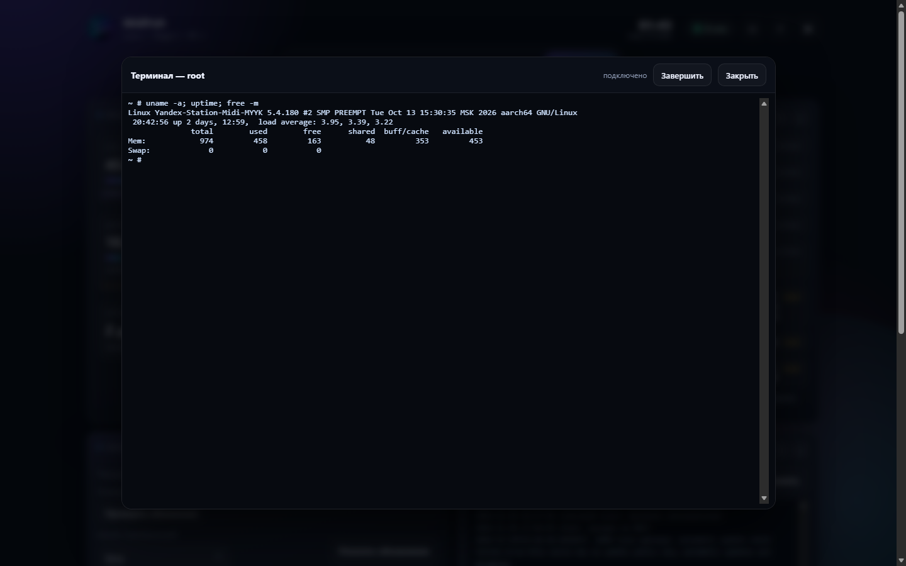
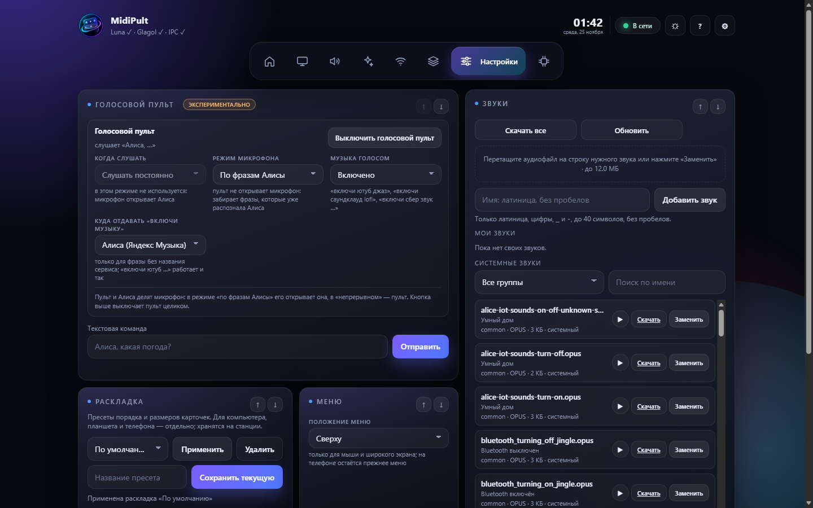
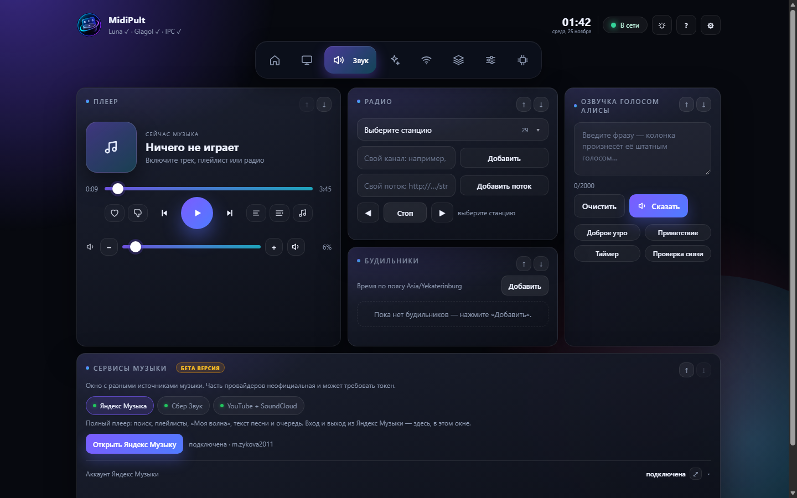
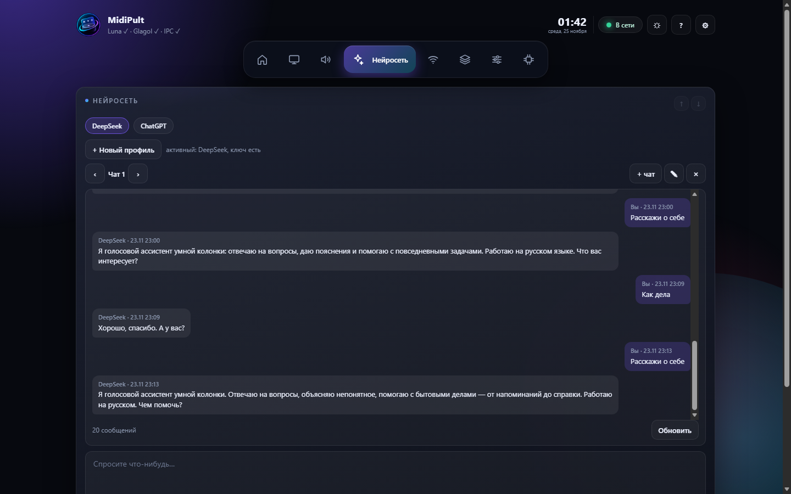
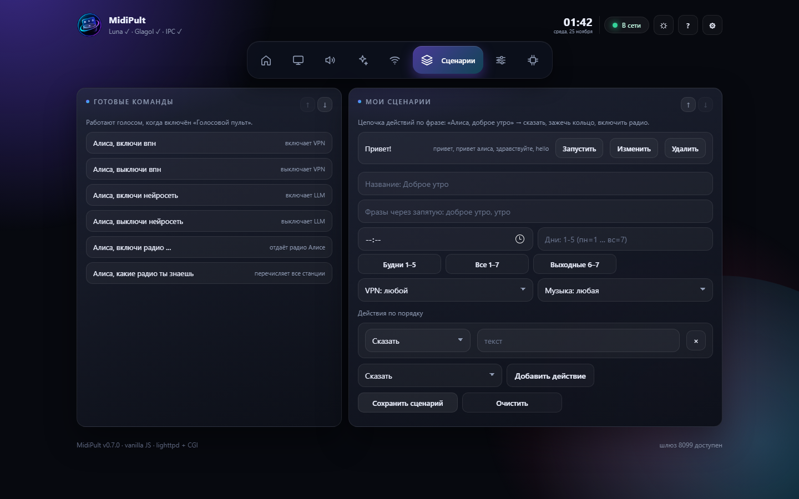

# MidiPult

<p align="center">
  
</p>

[](https://github.com/RoBiN19666/midipult/releases)
[](https://github.com/RoBiN19666/midipult/blob/main/LICENSE)

> **⚠️ ВАЖНО:**
> **Проект не связан с Яндексом. Использование только на вашем собственном
> устройстве. Вы делаете это на свой страх и риск. Автор не несёт
> ответственности за поломки, потерю данных или нарушение гарантии.**

Локальная веб-панель для рутованной **Яндекс Станции Миди**: дисплей, LED-кольцо,
плеер и радио, голосовые команды, нейросеть по API, VPN, Bluetooth, Wi-Fi,
сценарии с расписанием, резервные копии и диагностика.

На главной — интерактивная **3D-модель станции**: живой экран, LED-кольцо,
подсветка в углублении, выбор цвета корпуса и быстрый обзор состояния.

Текущая версия — **0.6.75**. Работает на самой колонке: `lighttpd` на порту **8055** + CGI на Python.
Интерфейс — один `index.html` на чистом HTML/CSS/JS, без React, Node и внешних CDN.
Исходники панели лежат в `src/panel/` (`index.html`, `css/`, `js/` по разделам),
а `index.html` — собранный артефакт: `python3 deploy/build_panel.py`. Руками его
править не нужно, CI проверяет, что он совпадает со сборкой.
На колонку попадает только собранный `index.html` — папка `src/` туда не
копируется и в архив обновления не входит. Правки: изменить файлы в
`src/panel/…`, затем `python3 deploy/build_panel.py` (проверка — `--check`).

[Все релизы](https://github.com/RoBiN19666/midipult/releases)

Клиенты для панели:

- [MidiPult Windows](https://github.com/RoBiN19666/midipult-windows) — приложение для компьютера:
  поиск станций, панель в WebView2 в одном окне со списком, портативный режим и установщик
  без прав администратора.
- [MidiPult Android](https://github.com/RoBiN19666/midipult-android) — нативная оболочка
  для телефона: поиск станций, карточки, меню и системный медиаплеер.

## Совместимость моделей

| Модель | device-tree | Что работает |
|---|---|---|
| Станция Миди (Cucumber, Amlogic A5) | `yandex,cucumber-dvt2` | всё |
| Станция 2 (YNDX-00051, Amlogic AXG) | `yandex,station-midi` | сеть, LLM, VPN, свои звуки, громкость, сценарии без кольца/дисплея; карточки дисплея и кольца скрыты, зато панель целиком гасится и регулируется по яркости (`panel.py`, `/sys/class/backlight/fb0`) |

Ловушка: у розничной **Станции 2** в device-tree тоже написано «Yandex Station Midi» —
это её внутреннее имя, а розничная «Станция Миди» называется `Cucumber`. Поэтому
установщик различает их по `compatible` (`cucumber` против `station-midi`), пишет
`/data/mypult/device.json` и предупреждает, если ставится на Station 2.

Панель в рантайме спрашивает `/cgi-bin/caps.py`: если на железе нет сегментного
дисплея (`cucumber:white:clock-*`) или sysfs-кольца (`*:ring*`), карточки дисплея
и кольца скрываются, а из действий сценариев убираются связанные с ними. Модули
при этом не удаляются: их импортируют голосовой демон и будильники, поэтому
«отключить» на уровне возможностей безопаснее, чем вырезать файлы.

## О создании проекта

Проект написан в паре с LLM-агентом. **yt-dlp** — извлечение потоков YouTube Music
(Unlicense), отдельный бинарник в `bin/yt-dlp`. **DeepSeek Harness** — среда, в которой
сгенерированы архитектура, CGI-скрипты, вёрстка и установщик. Постановка задач, тесты
на живой колонке, отладка Luna/Glagol/IPC `aliced` и финальная проверка — за автором.

## Скриншоты

| Дисплей | Кривая автояркости |
|---|---|
|  |  |

| Терминал | Настройки |
|---|---|
|  |  |

| Звук и радио | Нейросеть |
|---|---|
|  |  |

| Сценарии |  |
|---|---|
|  |  |

---

## Возможности

### Раскладка и карточки
- карточки можно перемещать и менять в размере за угол: ширина — колонки,
  высота — строки с шагом 48 px; двойной клик по ручке сбрасывает размер;
- **пресеты раскладки** в «Настройках»: три независимых набора — компьютер,
  планшет и телефон; сохранить текущую под именем, применить, удалить;
- в пресет входит и **положение меню** (сверху, снизу, слева, справа);
- положение меню настраивается отдельно для мыши, планшета и телефона; на
  планшете вкладки с подписями переносятся и центрируются, на десктопе
  раскрываются по наведению;
- пресеты хранятся на станции (`/data/mypult/layout_presets.json`), поэтому
  раскладку можно перенести на другой компьютер;
- свежая установка получает стоковую раскладку **«По умолчанию»**;
- «Логи» и «Звуки» подстраивают внутреннюю прокрутку под высоту карточки.

### 3D-модель и главная
- настоящая glTF-модель Станции Миди: вращение мышью/пальцем, зум, сброс двойным кликом;
- **живой дисплей** на модели повторяет время, рисунок и кадры анимаций;
- LED-кольцо на модели показывает те же цвета и градиенты, что и реальное кольцо, включая музыку;
- матовая чёрная верхняя панель, значок Алисы и родные «+»/«−» модели;
- **цвет корпуса**: чёрный, серый, изумрудный, малиновый, жёлтый — выбор сохраняется;
- настраиваемый логотип из 6 LED: как кольцо, фиолетовый, белый или выключен;
- карточка «Быстрый вид»: ресурсы, будильник, сеть, сценарии или нейросеть.

### Дисплей
- время и дата в шапке панели; на мобильной версии они скрыты;
- часы показывают локальное время панели; время станции задаёт сама
  Алиса/Luna, панель его не переставляет;
- кадры анимаций дисплея дублируются на экране 3D-модели;
- семисегментный редактор рисунка (A1…G4);
- бегущая строка через `/api/clock/text`: **до 32 символов**, только
  7-сегментный набор (цифры, `_`, `-`, часть латинских букв; кириллица не
  поддерживается);
- реальное гашение 45 LED-сегментов и возврат часов;
- **автояркость по кривой**: кнопка «Кривая» в карточке «Дисплей» — точки
  «освещённость → яркость», график с перетаскиванием, добавление кликом,
  удаление правой кнопкой и сброс; между точками яркость меняется плавно по
  логарифму освещённости. Без сохранённой кривой работает прежняя формула;
- сохранение текущего рисунка, чтобы «включить экран» не вернуло пустоту.

### Кольцо
- 24 RGB-диода: клик по диоду, пресеты, пипетка;
- режимы: сплошной, радуга, градиент, волна, свеча;
- при музыке и ответах Алисы кольцом управляет прошивка: свои цвета, волна и
  анимации в это время не применяются, чтобы не было конфликта;
- **логотип из 6 LED**: «как кольцо», фиолетовый, белый или выключен;
- 3D-модель повторяет цвета кольца, градиенты и анимации;
- панель читает реальные 24 диода из sysfs, поэтому видит и штатную анимацию прошивки при музыке;
- **скорость / дыхание**: 0 — ровный свет, выше — плавное «дыхание» или
  ускорение анимации; кадры идут напрямую в демон (~25 fps), настройка
  сохраняется в браузере;
- **яркость кольца** управляется током LED-контроллеров (0–255), сохраняется
  в `/data/mypult/ring.json` и восстанавливается после перезагрузки;
- **автояркость по датчику света** (выключена по умолчанию): 0 lux → минимум,
  яркий свет → максимум;
- **редактор своих анимаций кольца**: 24 диода по кадрам, сохранение в `.led`;
- **анимации из прошивки** (`ledpatterns/ring/*.led`) через `led_util`:
  «слушает», «думает», «говорит» и другие — выбор в карточке «Кольцо».

### Звук
- плеер: трек, исполнитель, обложка, play/pause/next/prev; название, обложка и источник
  сохраняются, пока станция не отдаст новые метаданные;
- **Яндекс Музыка**: вход по QR в окне «Сервисы музыки» (без вставки ссылок и токенов),
  полноэкранный раздел с поиском по трекам, альбомам, плейлистам, артистам, подкастам
  и аудиокнигам, «Моей волной», трендами, сохранёнными плейлистами и избранным; вход
  и выход — только в бета-окне сервисов, не в плеере;
- **Сбер Звук**: поиск и воспроизведение анонимно (128 kbps, без токена), но без
  аккаунта Звук отдаёт только 30-секундный фрагмент. Для полного трека, «Моего потока»
  и качества 320 нужен токен веб-сессии; в панели есть кнопки входа на zvuk.com и
  страницы `zvuk.com/api/tiny/profile` с инструкцией, какое поле копировать. Токен
  хранится только на станции;
- **YouTube Music + SoundCloud**: одна вкладка с общим поиском по двум сервисам и
  метками источника в результатах. YouTube отдаётся HLS-сегментами (ffmpeg собирает
  их на лету, полный трек не скачивается), SoundCloud — через HLS-прокси. Перед новым
  треком оба провайдера останавливаются, поэтому два источника не играют одновременно.
  Первый холодный запуск занимает несколько секунд, повторный — быстрее за счёт кэша
  ссылок; плеер показывает источник и обложку, а другие открытые панели синхронизируют
  текущий внешний трек;
- **волна**: кнопка «Волна» для Сбер Звука (персональная), YouTube и SoundCloud
  (подборка по настроению — поп, рок, спокойное, танцевальное, новое);
  очередь и авто-переключение живут в отдельном `musicd`, который запускается
  по требованию и завершается после 10 минут без волны. «Включи ютуб X» играет
  X, затем похожие треки; похожие можно выключить в «Голосовом пульте»;
- **с телефона (Bluetooth)**: телефон подключается к станции как к колонке, а панель
  работает пультом по AVRCP — название и исполнитель, play/pause, next/prev. Ползунок
  показывает позицию, но не перематывает: абсолютной перемотки в AVRCP нет. Если
  AVRCP в прошивке выключен, панель честно пишет, что управление осталось на телефоне
  (`docs/BLUETOOTH-REMOTE.md`);
- **Spotify (экспериментально)**: поиск по Web API с Client ID/Secret и открытие трека
  в Spotify. Spotify Web API не отдаёт аудио, поэтому для звука на станции нужен
  отдельный Spotify Connect/librespot;
- **текст песни** из LRCLIB (без ключей и входа) для любого источника, где есть
  название: если `artist` пуст, разбирается «Исполнитель - Название», результат
  выбирается по длительности ±5 секунд; полноэкранный оверлей с размытой
  обложкой, активная строка подсвечивается и плавно уезжает к центру, по строке
  можно перемотать; синхронизация — только если LRCLIB отдал LRC;
- **лайк / дизлайк** текущего трека через API Яндекс Музыки токеном станции —
  отдельный вход не нужен; на радио и внешних потоках кнопки неактивны, текст
  доступен, если есть нормальные название и исполнитель;
- **очередь, похожие и избранное** — диалог из плеера: текущий трек подсвечен, клик по
  строке включает трек; из Яндекс Музыки очередь открывается в её жёлтой теме, из
  панели — в фиолетовой;
- **плеер Яндекс Музыки** занимает экран по высоте, управление прижато к нижнему краю,
  страница и сам плеер не создают лишнюю вертикальную прокрутку;
- **анимации дисплея**: редактор кадров как в yapanel — рисуйте сегменты прямо в превью,
  добавляйте кадры и длительность, вставляйте время «Текст в кадр», сохраняйте и
  редактируйте на станции; пресеты «Подмигивание», «Моргание», «Змейка» проигрываются
  в превью и на самом дисплее, а кадры дублируются на 3D-модели;
- **будильники**: «Один раз» или «Повторять» по дням недели, время по поясу браузера,
  радио/Яндекс Музыка/свой звук/фраза, громкость и нарастание через ALSA, мигание
  кольца, «Отложить»; выключаются кнопкой Алисы, голосом, таймаутом или из панели;
  окно добавления помещается в экран, форма прокручивается, кнопка всегда видна;
- **плавная позиция**: состояние приходит пушем по постоянному WebSocket к Glagol, а
  между обновлениями панель сама досчитывает время — полоска не дёргается, текст не
  отстаёт;
- прогресс-бар и перемотка для треков; для радио полоска скрыта;
- 29 встроенных радиостанций и свои каналы: по названию (играет Алиса) или по прямой
  HTTP-ссылке — ссылка отдаётся штатному плееру станции (Glagol `audio_play`), Алиса
  и громкость остаются штатными;
- озвучка текста голосом Алисы через IPC `9875` (`speak.py`);
- громкость запоминается в `/data/mypult/volume.json` для синхронизации панелей и
  восстанавливается при старте пульта (`restore_volume`), дальше уровень меняется
  кнопками или панелью;
- открытые панели синхронизируют громкость между собой и с физическими кнопками
  колонки: пока открыта вкладка «Звук», уровень читается раз в 5 секунд, опрос не
  перебивает слайдер во время перетаскивания.

### Голосовой пульт (экспериментальная функция)

Перехват фраз Алисы пока нестабилен: Алиса может успеть ответить первой, а
продолжение без «Алисы» ловится не всегда — это ограничение Luna/`aliced`,
а не настройка. Ниже описано, что уже работает и какие есть компромиссы.

- «Алиса, включи/выключи впн»;
- «Алиса, включи/выключи нейросеть»;
- «Алиса, включи дипсик / чатжпт / опенроутер» — активация профиля по имени;
- «Алиса, выключи дипсик» — выключение LLM;
- «Алиса, следующий/предыдущий/новый/удалить чат», «какой чат»;
- «Алиса, включи радио …» — отдаётся штатной Алисе;
- «Алиса, какие радио ты знаешь» — перечисление станций;
- «свет» намеренно **не** перехватывается: этим словом управляет реле через
  «Дом с Алисой».
- **музыка голосом** (выключено по умолчанию, карточка «Голосовой пульт»):
  «Алиса, включи ютуб джаз», «включи саундклауд lofi», «включи сбер звук …» —
  пульт ищет и запускает трек через карточки сервисов. Если сервис не
  настроен, отвечает голосом и фразу Алисе не отдаёт. Spotify пока не
  поддерживается: нужен Spotify Connect. Если название не названо
  («включи ютуб», «включи музыку» с выбранным сервисом) — запускается
  имитация волны: у Звука персональная волна, у YouTube и SoundCloud
  случайный трек из поиска и автоматическое переключение дальше. Пока играет
  наша волна, «стоп», «пауза», «продолжи», «дальше» и «назад» управляют ею,
  а не Алисой.

**Режим простоя** (вкладка «Система» → карточка «Голосовой пульт»):
- «Только при сценариях и нейросети» — **по умолчанию на всех моделях, включая
  Миди**. Если не настроен ни один сценарий и выключена нейросеть, сессия
  распознавания не открывается: микрофон не занят, штатная Алиса отвечает как
  обычно. Голосовые команды из списка выше в этом режиме не работают, пока нет
  сценариев/LLM;
- «Слушать постоянно» — осознанный выбор: демон держит сессию всё время, и
  штатная Алиса может отвечать медленнее (она живёт в той же Luna и делит
  микрофон). Раньше это было дефолтом на Миди — отсюда жалобы на задержки;
- **Режим микрофона** («По фразам Алисы» / «Непрерывно»):
  «По фразам Алисы» — основной на Миди и включён там по умолчанию: своей
  сессии нет, пульт читает фразы, которые уже распознала Алиса (0.5–2 с
  после конца речи), и отменяет её ответ только для своих команд. Музыка,
  радио, видео, звонки, таймеры, будильники, напоминания, время и свет
  остаются Алисе. Минус: фразу нужно начинать с «Алиса».
  «Непрерывно» — устаревший: своя сессия распознавания, фраза приходит через
  20–50 с, возможны дубли. Оставлен для старых Luna и не-Миди.
  Продолжение без «Алисы» в режиме «по фразам Алисы» не работает: после
  отмены Алиса микрофон не открывает. Оно осталось только в «Непрерывном».
  Режим простоя относится только к «Непрерывно»: в режиме «по фразам Алисы»
  микрофон открывает сама Алиса.

**Полностью выключить** пульт можно кнопкой «Выключить голосовой пульт»: демон
останавливается, микрофон не трогается вообще. Вместе с ним перестают работать и
голосовые сценарии с будильниками — они живут в том же демоне.

Тумблер «Голосовой пульт» теперь запоминается в `voice.json`: выключенный пульт
не поднимается сам ни через минуту (watchdog), ни после перезагрузки — пока его
не включат из панели. Сценарии и будильники живут в демоне и работают в любом
режиме.

Из curl управление выглядит так:

```sh
curl -X POST -H 'Content-Type: application/json' \
     -H 'X-Requested-With: MidiPult' -d '{"stop":1}' \
     http://192.0.2.10:8055/cgi-bin/voicectl.py
```

Без `Content-Length` (его добавляет `-d`, даже пустой) lighttpd ответит
`411 Length Required`, без `X-Requested-With` — `403`: это защита от POST с
чужого сайта, а не требование PIN.

Ответ штатной Алисы отменяется через Luna `POST /api/alice/speech/cancel`
(он чистит и очередь отложенных ответов Алисы AI) и `maind --cli c`, а не
приглушением звука. Для команд, где демон говорит сам, отмена выполняется
перед озвучкой.

### Нейросеть
- провайдеры OpenAI, OpenRouter, DeepSeek, **Anthropic (Claude 5.5)** и свой OpenAI-совместимый сервер;
- **поиск в интернете**: галочка «Искать в интернете». Поиск делает сам
  провайдер, если умеет: OpenRouter — плагин `web`, OpenAI — `web_search` в
  Responses API. Для провайдеров без поиска (DeepSeek и др.) можно указать свой
  SearXNG; скрейпинга поисковой выдачи нет. Голосом включается фразой
  «поищи…», «что нового…»; в ответе показываются источники;
- несколько профилей с переключением чипом и голосом;
- **дата, время и место** передаются модели в каждом запросе (пояс браузера сохраняется сам);
- **чат в карточке ИИ**: лента последних 20 сообщений (голосовых и текстовых),
  время у каждого нового сообщения (`Вы · 21:42`), поле ввода и две кнопки —
  «Только в чат» и «В чат и озвучить» (ответ читает Алиса). Ctrl+Enter —
  отправить молча, Ctrl+Shift+Enter — с озвучкой;
- **чаты**: отдельная история на чат (последние 20 сообщений), переключение,
  создание и удаление из панели и голосом;
- ключ хранится на колонке и не возвращается в интерфейс;
- **длина ответа** выбирается в панели: Кратко 260 / Обычно 700 /
  Подробно 1400 / Полный 2000 токенов (это потолок, а не приказ писать длинно);
- **характер ответов**: своё поле system prompt в карточке «Нейросеть»;
- **продолжение разговора**: после ответа пульт включает микрофон и слушает
  следующий вопрос без «Алисы» (галочка «Слушать продолжение»; Luna
  `POST /api/alice/speech?cancel=true`, до трёх ходов);
  пусто — стандартный голосовой ассистент, свой текст применяется и к
  голосовым ответам, и к текстовому чату;
- для DeepSeek отключён режим размышлений — короткий ответ генерируется
  примерно за 1,5 секунды;
- показ количества токенов;
- ответ можно озвучить; длинный текст режется на куски по ~1700 символов и
  читается последовательно.

### Сценарии
- свои цепочки действий по фразе;
- действия: сказать, кольцо, погасить кольцо, радио, **свой звук**, громкость,
  текст на дисплей, **анимация дисплея**, VPN, нейросеть, пауза плеера, задержка,
  **HTTP-запрос**, **проиграть ссылку** (`play_url` — mp3, m4a, wav, ogg и другое:
  панель скачивает файл и при необходимости перекодирует его через `ffmpeg`
  в WAV, а играет тот же движок, что и «свои звуки», без правки `settings.toml`);
- **расписание**: время `ЧЧ:ММ` и дни (`1-5`, `1,3,5`, `6-7`), по локальному
  времени станции;
- **условия**: дни, интервал времени, VPN включён/выключен, музыка играет/пауза;
- планировщик работает в голосовом демоне и проверяет расписание каждые 30 секунд.

### Luna и кольцо: осторожно с `settings.toml`
Luna читает свой конфиг из `/data/quazar/luna/data/settings.toml`. Если создать
этот файл ради чего-то одного (например, чтобы разрешить сетевые потоки в
`[web.network]`), Luna перестаёт подставлять модельный профиль подсветки и
отдаёт кольцо как `custom` на 6 диодов — штатные анимации «слушаю/говорю» и
музыка начинают работать неправильно. В файле обязательно должна быть секция:

```toml
[led]
profile = "yandexmidi"   # или "station2" для Station 2
count = 24               # 89 у Station 2
```

`diag.py` теперь проверяет это и отдаёт блок `ring`: есть ли `settings.toml`,
есть ли в нём `[led]`, какой `profile`/`count` видит Luna и сколько диодов у
модели, плюс предупреждение, если секции нет.

### Если не работают плеер и радио (Glagol)

Плееру нужен `conversationToken`: OAuth-токен из `/data/quasar/account_storage.dat`
меняется на токен Glagol по `device_id`. Порядок поиска id:

1. `/data/mypult/glagol_device.json` — ручной, самый приоритетный:
   ```json
   {"device_id": "U00…", "platform": "yandexmidi"}
   ```
2. `/data/quasar/devices.json` — штатный список устройств (есть на Миди);
3. логи демонов `daemons_logs/*.log` — прошивка сама пишет
   `register?device_id=…&platform=…` при обращениях к облаку (так находится id
   на Station 2, где `devices.json` не создаётся).

Проверка одной командой:

```sh
/opt/bin/python3 /data/myweb/cgi-bin/glagol.py --probe
```

Она печатает модель и `compatible`, `host` и `resolved` (в какие адреса
резолвится `quasar.yandex.net`), найденные устройства, число OAuth-токенов,
`device_id_source` (откуда взят id: `arg`, `glagol_device.json`, `devices.json`
или `daemons_logs`) и код ответа токен-эндпоинта на каждый токен (сами токены
маскируются):

- `200` — токен рабочий, в поле `sub` видно `device_id`, к которому он выпущен;
- `403 AUTH_TOKEN_INVALID` — этот токен для Glagol не годится (в
  `account_storage.dat` их несколько, и не все подходят);
- `404 Unknown device … for user_id …` — токен рабочий, но `device_id` чужой.

Если `resolved` показывает локальные адреса, значит `quasar.yandex.net`
подменён (DNS, hosts, прокси) и коды ответов ничего не значат. Проверить
кандидата можно без записи файла:

```sh
/opt/bin/python3 /data/myweb/cgi-bin/glagol.py --probe --device-id R103JQ000BMYYK
```

Параметр `platform` на деле почти ни на что не влияет: с рабочим токеном и
верным `device_id` эндпоинт отвечает `200` и на `cucumber`, и на
`yandexstation_2`.

### Сеть
- VPN по https-подписке (sing-box, tun), выбор сервера, автозапуск;
- Bluetooth: питание, режим сопряжения, скан, подключение, A2DP-приёмник
  (телефон → Миди; вывод на внешние BT-колонки прошивка не поддерживает);
  пока телефон играет, плеер панели показывает трек и управляет им по AVRCP;
- Wi-Fi: статус, шлюз/MAC/DNS, скан, подключение, сохранённые сети, свой DNS;
- IPv6: переключатель; в сетях без глобального IPv6 отключается по умолчанию,
  чтобы приложения не ждали недоступный маршрут;
- Zigbee: статус сети и список устройств, команды через Алису.

### Система
- CPU, load average, память, температура SoC, диск, освещённость, аптайм;
- **графики за сутки** встроены в плитки CPU, температуры, памяти и диска;
- просмотр логов пульта, голосового демона и lighttpd;
- **файловый менеджер**: просмотр `/data`, `/opt`, `/tmp`, `/root`, `/etc` и
  `/var/log`, правка текстовых файлов, загрузка, скачивание, переименование и
  удаление; запись разрешена только в `/data/mypult` и `/tmp`, секреты
  (`auth.json`, токены, ключи) закрыты;
- проверка сети: шлюз, интернет, DNS, HTTP-задержка;
- замер скорости скачивания;
- очистка логов и `__pycache__`;
- перезагрузка и **чистое выключение** перед переносом колонки;
- перезагрузка показывает таймер и прогресс, а после восстановления связи —
  уведомление «Колонка перезагружена»;
- **резервная копия** настроек (LLM, VPN, сценарии, радио, DNS, кольцо, чаты,
  голос, автояркость, яркость/режим дисплея) и восстановление из файла;
- **обновления из панели**: раз в сутки проверка GitHub Releases, карточка
  текущей/доступной версии, окно «Обновить / Отмена», release notes,
  скачивание архива с SHA-256, бэкап и откат при ошибке; канал
  «стабильный / бета» и кнопка «Откатить обновление» (последняя резервная копия);
- **системные звуки**: список, прослушивание ▶, скачивание, автобэкап
  оригинала и замена drag-and-drop; входной файл конвертируется в Ogg Opus
  48 кГц моно или WAV 48 кГц моно через GStreamer. MP3-цель принимается только
  готовым MP3 (энкодера на колонке нет); после замены нужна перезагрузка;
- **свои звуки** в `/data/mypult/sounds`: загрузка с названием, drag-and-drop
  в общую зону, прослушивание, скачивание, переименование и удаление; имена —
  только латиница, цифры, `_` и `-`; доступны как действие «Свой звук» в
  сценариях;
- **терминал**: кнопка «Запустить терминал» открывает интерактивный PTY
  (xterm.js + WebSocket `/term`): работают `top`, `vim`, `mc`, Ctrl+C, стрелки
  и изменение размера окна; сессия одна, закрывается по `exit` или после
  15 минут простоя, требует включённый PIN;
- **настройки**: отдельная вкладка «Настройки» — голос, PIN, звуки, индикация
  панели, раскладка и положение меню вынесены из «Системы»;
- **характеристики**: модель, SoC, CPU, ОЗУ, eMMC, ядро, userspace и Quasar
  читаются из `/proc`/`/sys`; звук, LED, радио, питание и Zigbee взяты из
  статьи hackalice.me и помечены «вики»;
- **PIN** — по умолчанию выключен; после включения проверяется **на сервере**:
  без куки отдаётся только страница входа, `/index.html` запрещён;
- **PWA-ярлык**: manifest и иконка; на телефон можно добавить ярлык.
  Полноценная установка как приложения по HTTP не работает — нужен HTTPS
  и service worker;
- светлая тема и drag-and-drop карточек мышью; порядок хранится
  в `localStorage` браузера;
- постоянный state-демон на `127.0.0.1:8057`: `/state` отвечает за ~5 мс и
  отдаёт статус и плеер (~0,5 КБ); `?full=1` добавляет характеристики, диски
  и звуки (~21 КБ). При его недоступности панель возвращается к CGI. Ресурсы
  опрашиваются только на открытой вкладке «Система», а данные остальных
  разделов загружаются при их открытии.

---

## Требования

- Яндекс Станция Миди с **root** и **Entware** (`/opt` → `/data/opt/entware`).
  Entware — это базовая система пакетов; установщик пульта её не заменяет, но
  проверяет и доставляет недостающие пакеты через `opkg`;
- **Luna** ставится/чинится установщиком автоматически: проверенная сборка
  `0.2.39` для `yandexmidi`, SHA-256 сверяется, старая копия сохраняется;
- для VPN — доступ в интернет и ~20 МБ свободного места.

YAM панели **не нужен** и установщиком не ставится.

Установщик проверяет и при необходимости ставит через `opkg`:
`python3`, `lighttpd`, `lighttpd-mod-cgi`, `lighttpd-mod-proxy`, `curl`,
`ffmpeg`, `python3-websocket-client`. Если этого пакета нет в Entware, ставится
`websocket-client==1.9.2` через `pip`. Уже установленные пакеты он **не обновляет** —
только дополняет отсутствующее. Версии после установки записываются в
`/data/mypult/bootstrap.lock`, чтобы при следующем запуске было видно, что
изменилось.

Если пакеты ставить нельзя, запустите с `MYPULT_NO_PACKAGES=1` — установщик
только проверит и покажет, чего не хватает. `MYPULT_NO_BOOTSTRAP=1` отключает
автоустановку/ремонт Luna.

---

## Проверено на

- **Яндекс Станция Миди (Cucumber)**, прошивка
  **`0.369.1.46.4778262955.20261013`** (quasar 3.21;
  `/data/fw_version`: `data = 47.17`, `number = 0x6699`);
- ядро **5.4.180**, Buildroot **2023.11.1**;
- root + Entware, Luna на `8099`, `maind`, `aliced`, `bluealsad`, `unbound`.

На других версиях прошивки проект не проверялся: пути к Luna, sysfs и IPC
могут отличаться.

---

## Установка

### Быстрый старт

1. Скопируйте проект на колонку (см. `deploy/`).
2. Установите:
   ```sh
   sh deploy/install.sh
   ```
   Скрипт сам проверит root/Entware/пакеты, поставит недостающие через
   `opkg`, создаст автозапуск и запустит пульт.
3. Если автозапуск не создался — вручную:
   ```sh
   /opt/etc/init.d/S99mypult start
   ```
4. Откройте `http://<IP-колонки>:8055/`.

Установщик пишет только свой конфиг `/opt/etc/lighttpd/myweb.conf` и файлы
пульта; конфиги Luna, YAM и Entware он не перезаписывает. Существующий
`myweb.conf` и веб-файлы перед обновлением копируются в
`/tmp/mypult-backup-<дата>`.

### Автоустановка зависимостей

`deploy/preflight.sh`:

- требует root и `/opt/bin/opkg`;
- проверяет `/proc/device-tree/model`: это должна быть Станция Миди
  (`Cucumber`/`Midi`), иначе установка отменяется;
- проверяет `python3`, `lighttpd`, `mod_cgi`, `mod_proxy`, `curl`,
  `python3-websocket-client`;
- при отсутствии делает `opkg update` и `opkg install` **только недостающих**
  пакетов; `opkg upgrade` не вызывается;
- проверяет Luna и при недоступности ставит проверенную `0.2.39` с проверкой
  SHA-256 и бэкапом старого бинарника; `MYPULT_UPDATE_LUNA=1` — принудительно
  переустановить её;
- пишет `/data/mypult/bootstrap.lock` с версиями Python/lighttpd/пакетов и
  хешем Luna; при следующем запуске предупреждает, если что-то обновилось;
- проверяет IPC `9875`, `amixer`, `wpa_cli`, свободное место;
- `MYPULT_NO_PACKAGES=1` — только отчёт без установки;
- `MYPULT_NO_BOOTSTRAP=1` — не трогать Luna.

Установщик вызывает его автоматически до копирования файлов.

### Заливка с Windows

```powershell
.\deploy\push-to-station.ps1
```

Скрипт сам находит колонку, поднимает версию при изменениях и запускает
установку. Если найдено несколько SSH-кандидатов, он показывает список
(IP, наличие Luna, источник) и просит выбрать номер. После выбора
`preflight.sh` проверяет модель: не Cucumber/Midi — установка отменяется.
Флаги: `-Station <IP>`, `-NoBump`, `-NoInstall`, `-NoScan`,
`-Message "…"`.

---

## Автозапуск

- `/etc/init.d/S99mypult` — тонкий шим на ro-rootfs: передаёт аргументы
  `/opt/etc/init.d/S99mypult` (`start`/`stop`/`status`/`reload`);
- последний запускает IPC, Luna, lighttpd, восстанавливает громкость,
  запускает голосовой демон, state-демон, кольцо, DNS и VPN;
- `reload` перезапускает web, голос и state (SIGHUP в этой сборке конфиг не
  перечитывает), поэтому деплой гарантированно применяет изменения;
- состояние переживает перезагрузку: профили, чаты, сценарии, радио, кольцо,
  громкость, PIN, DNS, VPN-подписка.

Проверено реальной перезагрузкой: панель поднимается примерно за 55 секунд.

---

## Удаление

Скрипт лежит на колонке в `/data/mypult/uninstall.sh` и в репозитории —
`deploy/uninstall.sh`. Он удаляет только MidiPult и **не трогает Luna, YAM и
Entware**.

```sh
# посмотреть план, ничего не меняя
sh /data/mypult/uninstall.sh --dry-run

# обычное удаление: файлы пульта и автозапуск,
# настройки в /data/mypult сохраняются
sh /data/mypult/uninstall.sh

# полное удаление вместе с ключами, VPN, сценариями и чатами
sh /data/mypult/uninstall.sh --purge
```

Перед удалением делается бэкап в `/data/mypult-uninstall-<дата>`;
с `--purge` бэкап тоже остаётся. Перезагрузка не требуется.
`--yes` — без подтверждения.

---

## Безопасность

- По умолчанию панель **без PIN** и рассчитана на доверенную локальную сеть.
- PIN включается в «Система → PIN» и проверяется **на сервере**:
  - без куки `/` отдаёт страницу входа, а не приложение;
  - `/index.html` напрямую запрещён (403);
  - любой CGI без куки — 401;
  - удаление оверлея в браузере ничего не даёт;
  - 4–8 цифр для совместимости; рекомендуется 6–8, пять ошибок блокируют вход на 5 минут.
- Запросы с localhost (сам пульт и демоны) проходят без PIN; браузер из LAN —
  только с кукой после ввода. Кнопка «Заблокировать» сбрасывает сессию.
- `/luna/` напрямую не проксируется: панель ходит через `/cgi-bin/luna.py`
  (PIN + same-origin), Luna слушает только `127.0.0.1:8099`.
- Mutating-действия принимаются только POST и с того же origin; GET-ссылки их
  не запускают. PIN-попытки ограничены (5 ошибок → блокировка 5 минут).
- Для HTTP-сценария на loopback-адрес нужен явный allowlist
  `/data/mypult/url_allow.json` (`{"hosts": ["127.0.0.1"]}`); приватные
  LAN-адреса сценариев разрешены, метаданные/link-local — нет. VPN-подписка
  только https и только публичный хост.
- Забытый PIN: `rm -f /data/mypult/auth.json` по SSH.
- HTTPS намеренно не используется: самоподписанный сертификат даёт предупреждение,
  а Let's Encrypt требует публичный домен. Не публикуйте порт 8055 в интернет.
- CGI выполняются от root — это нужно для sysfs, `amixer` и `wpa_cli`.
- Секреты лежат в `/data/mypult` с правами `600`; запись JSON атомарная через
  уникальный временный файл (без гонок между параллельными CGI); резервная копия
  содержит ключи, её нужно хранить отдельно.
- VPN заворачивает трафик станции — учитывайте это.

---

## Ограничения

- **Zigbee**: полное управление локально невозможно, нужен режим хаба в
  приложении «Яндекс Дом»; пульт показывает статус и устройства.
- **Spotify**: готовые клиенты требуют glibc новее, чем в Entware 2.27.
- **YouTube Music / SoundCloud**: провайдеры неофициальные, зависят от `yt-dlp`
  и доступности сервисов. YouTube отдаётся HLS-сегментами, первый запуск холодного
  трека занимает несколько секунд; полный трек на диск не сохраняется. SoundCloud
  может ограничить поток. Ссылки на поток кэшируются на 5 минут.
- **Сбер Звук**: без аккаунта доступен только 30-секундный фрагмент. Публичного
  OAuth у сервиса нет; для полного трека нужен токен веб-сессии, который вставляется
  вручную. Анонимный токен нужен только для поиска.
- **VK Музыка**: провайдера в панели нет — VK отключил Implicit Flow (25.06.2024)
  и закрыл публичный audio API, официального доступа к аудио у сторонних приложений
  нет. Слушать можно с телефона: станция принимает звук по Bluetooth, а плеер панели
  работает пультом.
- **Алиса и сторонние потоки**: штатная Алиса не принимает прямые URL из фразы,
  пульт отдаёт их плееру через `audio_play`.
- **Распознавание речи** требует обращения «Алиса»; своего ASR без wake-word нет.
- **Алиса может ответить вместе с пультом.** Она получает фразу раньше демона,
  а Luna не отдаёт событие до старта облачного ответа. Отмена «стоп»/mute
  опаздывает. Текстовое поле и кнопки сценариев не запускают её диалог.
  Подробно — [docs/VOICE-LIMITS.md](docs/VOICE-LIMITS.md).
- **Кнопка микрофона** — recognition-only: после нажатия нужно сказать
  «Алиса, …». Безопасного push-to-talk через Luna нет.
- **Региональное радио** не выбирается: пульт передаёт Алисе только название,
  а поток и регион выбирает её каталог.
- **Статический IP** и HTTPS не реализованы осознанно.
- Обновления ставятся из GitHub Releases: раз в сутки панель проверяет релиз,
  качает архив по HTTPS и сверяет SHA-256; без интернета проверка просто не
  выполняется, обновление можно залить вручную. В релизе должны быть
  `midipult-<версия>.tar.gz` и `.sha256` — иначе панель пишет «В релизе
  панели нет архива обновления»; как их приложить, см.
  [docs/GITHUB.md](docs/GITHUB.md). Если интернета или DNS нет совсем, архив можно
  положить в `/tmp` через «Файлы» и поставить кнопкой «Установить из файла» в карточке
  «Обновление» (с 0.6.16): панель проверит архив и откатится при ошибке.
- Канал обновлений хранится в `/data/mypult/update.json`: на «бете» видны
  prerelease-релизы, переключение обратно на стабильный канал предлагает
  вернуться на стабильную версию, даже если она младше установленной беты.
- FastCGI в этой сборке отсутствует; его роль для `/state` выполняет
  постоянный локальный демон.

---

## Зависимости и благодарности

**Luna** ([nyakokitsu/luna](https://github.com/nyakokitsu/luna)) — локальный
API-шлюз для LED, дисплея, датчиков и микрофона. Должна быть установлена и
запущена на порту **8099**; в репозиторий не входит.

**YAM** ([nyakokitsu/yam](https://github.com/nyakokitsu/yam)) — пакетный
менеджер экосистемы. Не обязателен, совместим и не конфликтует.

**yapanel-web** ([dimap/yapanel-web](https://github.com/dimap/yapanel-web)) —
веб-панель для станций с root по adb. Оттуда взяты проверенные на Миди идеи:
директива Glagol `audio_play` для своих потоков (играет штатный плеер станции),
`maind --cli` для отмены речи и запуска диалога, анимации кольца через
`led_util`, текст песни из LRCLIB. Спасибо автору.

**Entware** — Python, lighttpd, CGI-модули и утилиты устанавливаются в `/opt`.

**Yandex Station Extended**
([Marker284/yandex-station-extended](https://github.com/Marker284/yandex-station-extended),
[hackalice.me](https://hackalice.me/)) — публичная wiki по станциям: сведения
о Cucumber, путях системных звуков, `quasar`/`Glagol` и восстановлении.
Спасибо авторам и участникам.

**4PDA**, ветка
[«Взлом Яндекс станции»](https://4pda.to/forum/index.php?showtopic=1128279) —
за публичные материалы, шапку и обсуждение станций. Отдельная благодарность
**UNF0X** за кураторство шапки.

**GStreamer** — конвертация и воспроизведение звуков; **FFmpeg** — HLS-поток
YouTube Music; **sing-box** — VPN;
**lighttpd**, **Python**, **OpenSSH/socat**, **unbound** и **wpa_supplicant** —
штатные компоненты, на которых работает пульт.

**Яндекс** — Алиса, `quasar`, `maind` и `Glagol`; это проприетарные компоненты
колонки, проект с ними не аффилирован.

**lolfeke** — автор 3D-модели Станции Миди на Sketchfab
([CC BY 4.0](https://creativecommons.org/licenses/by/4.0/)). Спасибо за модель,
на которой построена главная страница.

**Kazuhiko Arase** — QR Code Generator for JavaScript
([MIT](https://github.com/kazuhikoarase/qrcode-generator)),
`assets/qrcode.js` для входа в Яндекс по QR.

**DeepSeek Harness** — среда, в которой проект разрабатывался вместе с
LLM-агентом: архитектура, CGI, вёрстка, тесты и релизная сборка. Спасибо
команде за инструмент.

---

## Документация

- [FAQ.md](FAQ.md) — частые вопросы, команды, проблемы и решения.
- [SECURITY.md](SECURITY.md) — политика безопасности и как сообщить об уязвимости.
- [docs/ARCHITECTURE.md](docs/ARCHITECTURE.md) — процессы, CGI, потоки данных,
  хранение, безопасность, ограничения.
- [docs/VOICE-LIMITS.md](docs/VOICE-LIMITS.md) — почему Алиса отвечает вместе
  с пультом, что нельзя исправить и как обойти.
- [docs/BLUETOOTH-REMOTE.md](docs/BLUETOOTH-REMOTE.md) — пульт для музыки с
  телефона: что умеет AVRCP, чего не умеет и как проверить, что он есть.
  нужно, чтобы он появился.
- [CHANGELOG.md](CHANGELOG.md) — история версий.

---

## Лицензия

MIT. См. [LICENSE](LICENSE).


