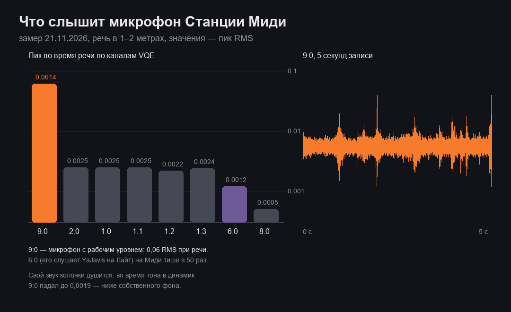
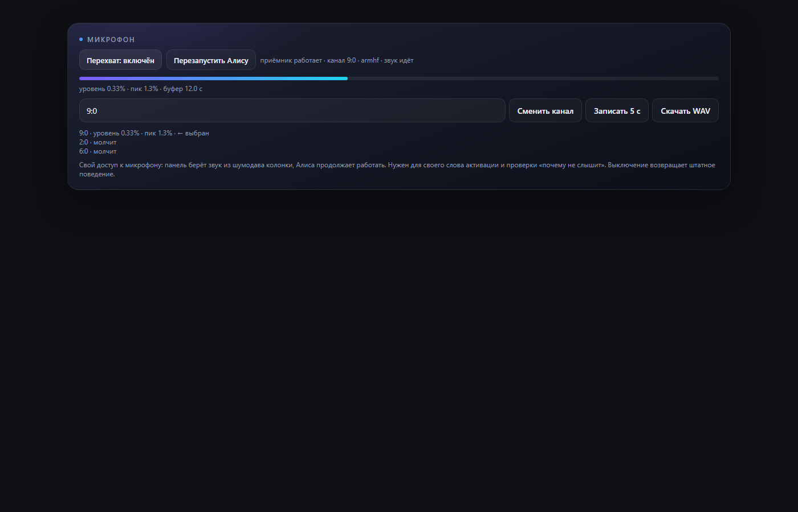

# Перехват микрофона (tap)

Документ описывает необязательную функцию ветки `feature-test`: панель получает
копию обработанного микрофона колонки, не отбирая его у штатной Алисы.

Состояние: **бета**. На Миди (Cucumber DVT2, aarch64-ядро, 32-битный `maind`)
проверено на живой колонке: кадры идут, речь на канале `9:0` доходит до 0.06 RMS, Алиса работает.
Дальше на этом сигнале будет построено своё слово активации.

---

## 1. Зачем

Сейчас голосовой пульт слышит только через `Luna /api/alice/recognize` — то есть
**после** полного облачного распознавания Алисы. Отсюда все известные ограничения:

- обязательно говорить «Алиса»;
- штатная Алиса успевает начать ответ раньше, чем панель получит текст;
- отмена её озвучки — всегда гонка.

Свой доступ к микрофону снимает эти ограничения: можно распознавать слово
активации локально и запускать диалог до того, как Алиса что-то скажет.

---

## 2. Как это работает

```
maind --platformd  (штатный процесс Quasar)
  │  YandexVqeC_GetOutputChannelData() — выход шумодава/эхоподавления
  │  LD_PRELOAD=/data/mypult/mictap/vqe_tap.so
  ▼
vqe_tap.so  — вызывает оригинал, не меняя ни буфер, ни errno,
              и копирует кадры в unixgram-сокет
  ▼
/tmp/mypult/mic.sock   (4 байта заголовка: kind, index, frames LE + s16le)
  ▼
/data/mypult/micd.py   — кольцевой буфер 12 с на канал, уровень, запись WAV
  ▼
127.0.0.1:8058  →  cgi-bin/mic.py (PIN + same-origin)  →  панель
```

`launch.json` не правится: в `/data/mypult/mictap/` лежит копия с добавленным
`LD_PRELOAD` для task `maind --platformd`, и она подкладывается **bind-mount'ом**.
Откат — `umount`, обновление прошивки не теряется: патч пересобирается из
системного файла при каждой загрузке.

Пути Quasar не зашиты: если привычных `/system/vendor/quasar/maind` и
`launch.json` нет (Станция 2, другая прошивка), скрипт берёт `launch.json` из
командной строки запущенного launcher'а, а путь к `maind` — из самого файла.

### Какой канал слушать

VQE отдаёт больше десятка каналов: сырые микрофоны, промежуточные, выход AEC.
Замер на живой Миди (речь в 1–2 метрах, 21.11.2026):

| Канал | Фон | Пик во время речи | Что это |
|---|---|---|---|
| **`9:0`** | 0.006 | **0.0614** | микрофон с рабочим уровнем, эхо своего звука душится |
| `2:0`, `1:0…1:3` | 0.0005 | 0.0025 | микрофонная решётка, тихо |
| `6:0` | 0.0001 | 0.0012 | то, что слушает YaJavis на Лайт; на Миди на два порядка тише |
| `4:0…4:3` | 0.0000 | 0 | служебные, пусто |

Поэтому **по умолчанию на Миди выбран `9:0`**. Собственный звук колонки в нём
душится: во время тона в динамик канал падал до 0.0019 — ниже своего же фона,
значит слово активации не будет слышать сам себя.

Полный список каналов вашей прошивки пишется в `/tmp/mypult/mic.sock.seen`.
Если `9:0` не подходит: `apply all` (все каналы), затем `apply 2:0` нужный.



---

## 3. Включение

```sh
# на колонке
sh /data/myweb/deploy/mic-tap.sh status      # что есть сейчас
sh /data/myweb/deploy/mic-tap.sh apply       # смонтировать, канал 9:0
sh /data/myweb/deploy/mic-tap.sh restart     # перезапустить Quasar (Алиса замолчит ~10 с)
```

После `apply` перезапуск нужен один раз: `LD_PRELOAD` читается при старте
процесса. При следующей загрузке колонки `S99mypult` смонтирует `launch.json` и,
если `maind` без preload, один раз перезапустит Quasar сам.

Выключить:

```sh
sh /data/myweb/deploy/mic-tap.sh remove
sh /data/myweb/deploy/mic-tap.sh restart
```

Из панели: `POST /cgi-bin/mic.py {"action":"apply"}` (и `remove`, `restart`).
CGI требует PIN и тот же origin, как и остальные изменяющие запросы.

---

## 4. Проверка и диагностика

```sh
sh /data/myweb/deploy/mic-tap.sh status
cat /tmp/mypult/mic.sock.seen          # какие каналы приходят, pid, потери
```

Через панельный CGI:

```sh
curl -s 'http://127.0.0.1:8055/cgi-bin/mic.py'                 # статус и уровни
curl -s -X POST http://127.0.0.1:8055/cgi-bin/mic.py \
     -H 'Content-Type: application/json' -H 'X-Requested-With: MidiPult' \
     -d '{"action":"record","seconds":5}'                      # запись в /data/mypult/micrec
```

Записи лежат в `/data/mypult/micrec`, хранятся последние 8 штук, права `600`.
Скачать: `GET /cgi-bin/mic.py?wav=mic-….wav`.

### В панели

Вкладка **«Система» → «Микрофон»**:



- тумблер перехвата (включить/выключить, `apply` и `remove`);
- живой уровень и пик выбранного канала;
- список всех приходящих каналов с уровнями;
- смена канала (`9:0` или `all`) и запись 5 секунд со ссылкой на WAV;
- кнопка «Перезапустить Алису» — появляется, когда preload ещё не применён.

Уровень карточка берёт из `GET /mic` — это прокси lighttpd прямо в `micd`, без
запуска CGI на каждый тик опроса. Если прокси в конфиге нет, панель сама
падает на `/cgi-bin/mic.py`. PIN проверяет `micd` по куке: через прокси все
запросы приходят с loopback, поэтому доверять адресу нельзя.

### Если тишина

1. `status` — есть ли `bind-mount: да` и `приёмник: работает`.
2. `.seen` — появились ли строки `channel …`. Если появились только служебные
   (pid/gain/drop), значит `maind` не зовёт VQE — tap не подходит этой прошивке.
3. Если `9:0` не приходит, включите все каналы и посмотрите список:
   `sh /data/myweb/deploy/mic-tap.sh apply all` → `restart` → `.seen`.
   Затем укажите нужный: `apply 2:0`.
4. Уровень очень низкий — поднимите усиление в `launch.json`
   (`MYPULT_MIC_GAIN=4`), но сначала убедитесь, что рядом с колонкой есть звук.

---

## 5. Слово активации «Джарвис»

Детектор работает прямо на потоке `micd`: 40 мел-полос → 48 каналов →
шесть свёрток с dilation 1,2,4,8,16,32 → вероятность, сглаженная за 3 кадра.
Модель — 175 КБ (`service/wake/wake.bin`), формат `JKWS1`, только numpy:
ни TensorFlow, ни ONNX на колонке не нужны.

Модель и архитектура взяты из проекта **YaJavis** (MIT, newfpv/YaJavis:
`jarvisd/kws.go`, `kws/train.py`), обучена на слове «Джарвис». Мы её не
переобучали — она проверена на Миди и работает.

### Что показал замер

| Проверка | Результат |
|---|---|
| «Джарвис» × 4–5 за две минуты | пик **0.998**, 3 срабатывания |
| фон комнаты без слова | 0.0004–0.05 (порог 0.9) |
| цена на кадр (Миди, aarch64) | ~1,5 мс → **~15 % одного ядра** |

Порог берётся из таблицы чувствительности 1–10 (5 → 0.9, 10 → 0.5),
после срабатывания — пауза 1,5 с, чтобы хвост слова не считался вторым.

### Включение

В карточке «Микрофон» — кнопка «Слово» и ползунок чувствительности
(настройка в `/data/mypult/wake.json`). Включается отдельно от перехвата:
без `numpy` детектор просто не запустится, всё остальное работает.

Сейчас детектор **только считает срабатывания** и показывает вероятность:
что делать по слову — следующий шаг (запускать распознавание, сценарий или
свой диалог). Ложные срабатывания на обычной речи ещё измеряются.

## 6. Стоимость

| Что | Значение (Миди) |
|---|---|
| Перехват: один канал | ~0,2 % ядра (12 каналов — ~14 %) |
| Память `micd.py` | ~34 МБ RSS, буфер 12 с на канал |
| Задержка до приёмника | один `sendto`, порядка микросекунд |
| Влияние на Алису | нет: оригинальный буфер не меняется, отправка неблокирующая |

---

## 7. Ограничения и риски

- Tap грузится **в чужой процесс**. Несовпадение ABI (архитектура, glibc) —
  и `maind` не стартует. Поэтому `.so` собирается под обе архитектуры, а
  `apply` проверяет ELF-класс `maind` и наличие символа. Если символа нет —
  tap просто не включается.
- В отличие от версии из YaJavis, при неудачном `dlsym` наш tap **не** вызывает
  `_exit(2)`: чужой процесс ронять нельзя.
- Сокет `0600` и `127.0.0.1` — снаружи колонки звук недоступен. Записи не
  отправляются никуда.
- Перезапуск Quasar обрывает текущий диалог и музыку на ~10 секунд.
- При обновлении прошивки `launch.json` может измениться: `mount_only`
  сравнивает базовую копию с системным файлом и пересобирает патч.
- На Станции 2 раскладка VQE не проверена. Канал по умолчанию тот же (`9:0`),
  `apply all` покажет реальную.

---

## 8. Сборка `.so`

```sh
ZIG=/путь/к/zig sh service/mictap/build.sh
```

Нужен только `zig` (0.13+), Python и видеокарта не требуются. На выходе:

| Файл | Для кого |
|---|---|
| `vqe_tap-armhf.so` | 32-битный ARM: Миди/Cucumber (там `maind` ELFCLASS32) |
| `vqe_tap-aarch64.so` | 64-битный ARM: Станция 2 и другие на arm64 |

glibc пришпилен к 2.28 — на Миди 2.32, запас есть.
